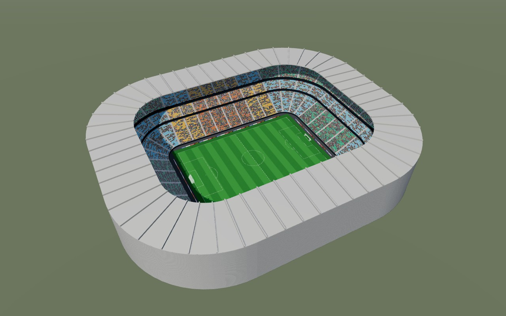
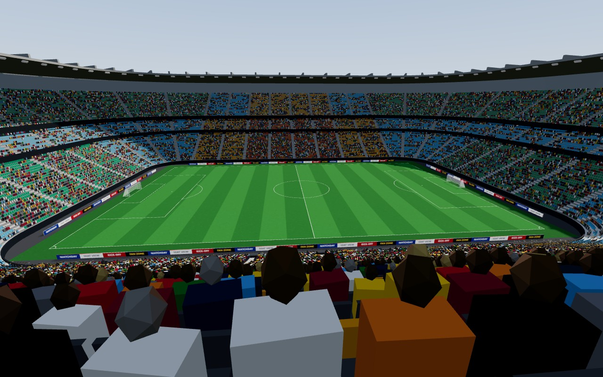
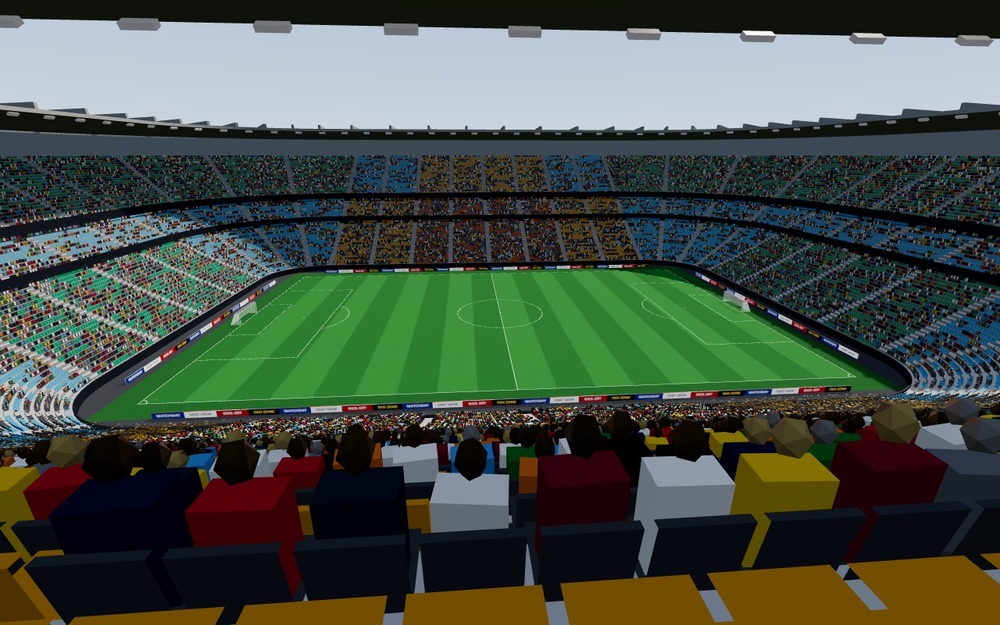
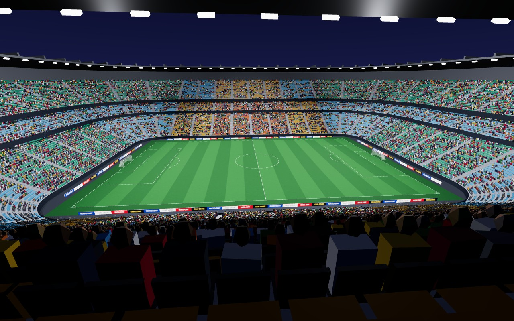
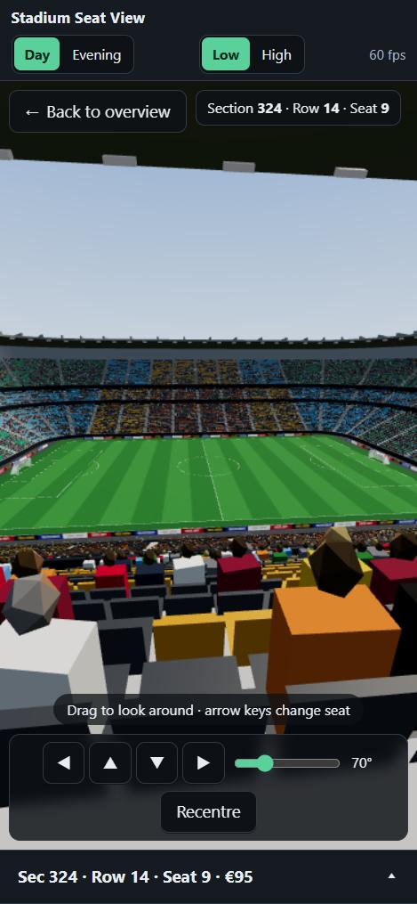

# Stadium Seat View: Project Document

A complete record of the project: what it is, how it is built, how it was developed and verified, what is still approximate, and what it would take to turn it into a product.

For day-to-day use, see [README.md](README.md) (run instructions, config reference, plugging in a real stadium). For full test data, see [docs/VERIFICATION.md](docs/VERIFICATION.md).

---

## 1. Summary

Stadium Seat View is a web app that lets football fans preview the view from any seat in a stadium before buying a ticket. It renders a procedurally generated three-tier stadium in 3D in the browser. Fans can orbit the bowl, click a section, click a seat and fly into a first-person view from that seat. Prices, availability and filters come from a mock ticketing data file.

| | |
|---|---|
| Stack | Vite 8, TypeScript 7, Three.js 0.187. Plain DOM/CSS UI. No backend, no other runtime libraries |
| Size | About 3,900 lines of TypeScript plus one stylesheet |
| Stadium | 120 sections (101–140, 201–240, 301–340), 54,448 seats, cantilevered roof |
| Tickets | 4 price categories, 34,963 seats sold (64%), deterministic mock data |
| Output | Static site (`dist/`), about 670 KB of JavaScript (174 KB compressed) plus 1.9 MB of JSON data |
| Location | `C:\Users\berni\stadium project` (not yet a git repository) |



---

## 2. Status at a glance

**Done**
- All six planned phases: stadium, seats and selection, seat-view camera, ticketing layer, realism and mobile, documentation
- Sightlines designed so every seat sees the near touchline over the head in front: minimum 84 mm clearance, median 115 mm
- Camera never enters the building: 0 violations across 11,223 checked animation frames and 96 forced-camera tests
- 60 fps on High on an Intel Iris Xe at window sizes up to 2560×1440, with adaptive resolution on large windows
- Keyboard-only use, accessible names and WCAG AA colour contrast checked; issues found were fixed
- README, verification report and screenshots

**Known gaps**
- The stadium is generic: no real venue has been modelled
- Ticketing is mock data with no real ticketing-system integration
- A full-screen 4K window on this laptop's GPU reaches about 53 fps on High in upper-tier views (Low holds 60)
- Not tested on:
  - real phones
  - other GPUs
  - Firefox or Safari
  - screens faster than 60 Hz
  - with a screen reader

---

## 3. How to run

Requires Node.js 20+ (developed on Node 24).

```bash
npm install
npm run dev          # http://localhost:5173
npm run build        # type-check + static build into dist/
npm run preview      # serve dist/
```

Starting the dev server or a build regenerates `public/data/stadium.json` and `public/data/tickets.json` from [`src/config/stadiumConfig.ts`](src/config/stadiumConfig.ts). Set `STADIUM_DATA=external` to keep hand-supplied data instead.

A specific seat can be linked directly, for example `http://localhost:5173/#S-324-R22-N09`.

---

## 4. Features

### Stadium model (procedural)
- **Pitch:** 105 × 68 m, with full markings to the Laws of the Game:
  - halfway line and centre circle
  - penalty areas, goal areas, penalty spots and arcs
  - corner arcs
- **Around the pitch:** goals with nets, mowing stripes, a surrounding track and advertising boards.
- **Bowl:** three tiers in a rounded-rectangle shape.
  - Lower tier: 24 rows. Middle tier: 10 rows. Upper tier: 22 rows.
  - Each tier has 8 sections per sideline, 4 per end and 4 per corner.
  - Sidelines, ends and corners are distinct zones.
- **Sightline-designed rake:** each row's step height is calculated from a target sightline clearance, so the steps get slightly steeper towards the back. Rakes are about 24°→31° (lower), 31°→32° (middle) and 34°→35° (upper), capped at 35°.
- **Roof:** a cantilevered ring reaching 30 m in over the seats, with girders and a row of floodlight fixtures. It clips the top of the view from upper rows.
- **Building:** generic walls between tiers, walkways, a back wall and an outer facade.
- **Seats:** 54,448 of them, drawn as one instanced mesh per section. Each chair is 10 triangles up close and 4 far away.

### Camera
- **Orbit mode:**
  - rotate, zoom and pan with mouse or touch
  - limits on how far the camera can go
  - automatically lifted over the stands and roof, so it can't enter the building
- **Section view:** clicking a section flies the camera to frame it, and dims the other sections.
- **Seat view:**
  - first-person camera 1.2 m above the step the seat stands on
  - initially aimed at the centre spot
  - drag or W/A/S/D to look around, up to ±110° left/right
  - field of view 60–100° by slider, mouse wheel or +/−
  - R recentres the view
- **Animated flights:** the camera arcs in over the roof and drops into the bowl, entering the seat along its own line of sight. Short moves to a neighbouring seat are quick hops that arc upwards so they clear the walls at the front of each tier.
- **Portrait phones:** the FOV setting applies to the screen's width, so the whole pitch fits (vertical FOV capped at 105°).

### Seat selection
- Hover tooltip: section, row, seat number, category, price and status.
- Click a section to zoom in, then click a seat to fly into its view.
- Section → Row → Seat dropdowns do the same without precise clicking. They show free-seat counts and disable sold seats.
- Keys:
  - arrow keys move to the adjacent seat or row, crossing aisles, sections and tiers, and skipping sold or filtered seats
  - Esc returns to the overview
- On-screen buttons for the same seat moves, for touch and mouse-only users.
- Seat IDs are stable and deterministic, for example `S-214-R12-N07`. The selected seat is kept in the URL, so links can be shared and reloaded.

### Ticketing layer (mock)
- **Four price categories:**

  | Category | Price | Pattern |
  |---|---|---|
  | A Premium | €145 | solid |
  | B Central | €95 | stripes |
  | C Standard | €65 | dots |
  | D Value | €40 | crosshatch |

  Colours come from a palette designed to stay distinguishable for colour-blind viewers. Each category also has a letter and a pattern, so colour is never the only cue.
- **3D colouring:** available seats show their category colour, sold seats are grey, and seats outside the filters fade.
- **Section tags:** a floating "214 C" tag on the front wall of each section, fading in as the camera gets closer.
- **Legend and filters:** the legend doubles as the category filter. There are min/max price sliders, live counts of matching seats, a Reset button and a section-tag toggle.
- **Sold or filtered seats** can't be selected by click, dropdown or arrow keys. Clicking one shows the reason, which also works on touch screens.
- **Seat card:** shows the seat's details, a "View from this seat" button and a "Select seat" button. Select stores the seat in the app's state; there is no checkout.

### Realism
- **Day:** a gradient sky, distance fog, and sun shadows from the roof and stands onto the seats and pitch. Shadows are drawn once and redrawn only when lighting changes.
- **Evening:** a dark sky, an overhead white light standing in for the floodlights, four corner spotlights, glowing roof fixtures, brighter ad boards and a darkened building exterior.
- **Crowd:** 33,000+ seated figures, one on every sold seat.
  - Shirts in mixed colours; faces from the front and hair from behind.
  - Slight random turn and size for each figure.
  - Two detail levels.
  - The figure on the camera's own seat is removed.

### Quality and performance
- **Low/High switch:**

  | | High | Low |
  |---|---|---|
  | Shadows | on | off |
  | Crowd | every sold seat | 40% of sold seats |
  | Detailed crowd figures within | 45 m | 25 m |
  | Pixel ratio | up to 1.5× | 1× |

  Touch screens and narrow windows start on Low.
- **Adaptive resolution:** when the frame rate stays below 58 fps, it renders fewer pixels, one step at a time.
  - Floor on ordinary windows: 0.7×.
  - Floor on very large windows: about 1080p-equivalent sharpness.
  - It steps back up once performance is steady, waiting longer each time a step back up has to be undone.
  - The fps readout shows when resolution is reduced, for example "60 fps · 76% res".
- **Loading screen** with progress steps, and an FPS readout in the top bar.

### UI and accessibility
- **Desktop:** a side panel.
- **Mobile:** a bottom sheet that shows the current seat and price, and folds away when you enter a seat view.
- **Labels:** every input has a label, the time and quality switches are labelled groups, and buttons have descriptive names.
- **Keyboard:** everything works without a mouse, focus rings are visible, and focus is kept when controls hide or become disabled.
- **Contrast:** all text meets WCAG AA (4.5:1).

---

## 5. Architecture

### Module map

```
plugins/stadiumDataPlugin.ts   Vite plugin: config -> public/data/*.json at startup
src/
  config/stadiumConfig.ts      All stadium dimensions (only file to edit for a different bowl)
  data/                        No three.js in the generators
    types.ts                   StadiumConfig, StadiumData, TicketData
    generateStadium.ts         config -> StadiumData (pure, deterministic; sightline-designed rake)
    generateTickets.ts         StadiumData -> TicketData (seeded mock)
    bowlPath.ts                rounded-rectangle bowl geometry, shared by generator and renderer
    envelope.ts                stand and roof heights for keeping the camera outside the building
    loadData.ts                load + validate stadium.json; seat indexing; neighbour search
    tickets.ts                 load + validate tickets.json; availability and filter lookups
    seatId.ts                  "S-214-R12-N07" format and parse
  state/store.ts, actions.ts   Tiny pub/sub store; every user intent goes through actions
  camera/cameraController.ts   Orbit, section and seat views; animated flights
  interaction/                 Picking (section proxies + seat raycast), pointer, keyboard
  scene/                       Pitch, stands, seats, roof, crowd, labels, lighting, quality
  ui/                          Panel, legend/filters, overlay, tooltip, HUD, styles
```

### Data flow

```
stadiumConfig.ts --(Vite plugin at startup)--> stadium.json + tickets.json
                                                       |
                                     fetched + validated at page load
                                                       |
                Stadium / Tickets indexes --> scene builders (steps, seats, crowd, labels)
                                                       |
   pointer / keyboard / panel --> actions --> store --> seat colours, panel, overlay, camera
```

The renderer reads only the JSON, never the config. Swapping in a real stadium is a data change, not a code change.

### Key design decisions

| Decision | Why |
|---|---|
| Seat data as plain JSON, stored as `[seat, x, y, z, yaw]` tuples | Swappable for a real venue; compact; IDs derived from the numbers, not array positions |
| Steps under the seats built from the seat rows themselves | They always match whatever seat data is loaded |
| One InstancedMesh per section, not one for all 54k seats | Off-screen sections are skipped cheaply, recolouring touches one section at a time, and seat picking only tests one section |
| Invisible low-poly sheet over each section for picking | Testing 120 sheets is far cheaper than testing 54k seats; the exact seat is found afterwards within that section only |
| Two detail levels for seats (10/4 triangles) and crowd (30/4) | Cut the triangle count from 1.3 M to about 0.25–0.5 M |
| Shadows drawn once, redrawn only when lighting changes | Nothing that casts a shadow moves, so redrawing every frame would be wasted |
| Camera flights travel above the building, then enter along the seat's own line of sight | The line of sight is the one path guaranteed to be clear under the roof |
| Step heights solved from a sightline target (standard stadium design method) | Guarantees views over heads instead of hoping a fixed rake works |
| Lower resolution rather than switching shadows off when slow | Measured as the effective fix (the slow views were limited by pixel count), and it avoids the lighting visibly popping |
| No state or animation library | The store is about 40 lines and the camera easing is one function; fewer dependencies |

---

## 6. Data model and configuration

Full reference in [README.md](README.md#stadium-config). In short:

- **`stadiumConfig.ts`:**
  - pitch size and run-off distances
  - corner radius, seat spacing, aisle width
  - sections per zone
  - per tier: rows, row depth, minimum rake, sightline target (`cValue`), setback, lift, front-wall height
  - roof and facade dimensions
  - eye height
- **`stadium.json`:** pitch size, seat-spacing hints, an optional generic `shell` (the walls and roof), and `sections[]`, each with rows of `[seat number, x, y, z, yaw]`. Coordinates: origin at the centre spot, X along the pitch, Z across, Y up, metres.
- **`tickets.json`:** the price categories, a category per section, and the sold seat keys per section.
- **Seat IDs:** `S-{section}-R{row:2}-N{seat:2}`.

The README includes a tested CSV → `stadium.json` converter: it round-tripped all 54,448 seats identically.

---

## 7. Development history

The work followed an agreed plan in six phases, stopping after each for review.

| Phase | Delivered | Problems found and fixed |
|---|---|---|
| 1. Scaffold, pitch, empty bowl | Vite/TS/three setup, config, data generator, pitch with markings, goals, boards, stepped stands, orbit camera | Data file not written early enough for the first page load; the config loader needed explicit `.ts` import extensions |
| 2. Seats and selection | Instanced seats, section picking, tooltip, click to zoom/select, dropdowns, link to selected seat | 24-triangle chairs made 1.3 M triangles: rebuilt at 10/4 triangles with two detail levels; hidden Back button still showing; Esc guard bug |
| 3. Seat-view camera | Animated flights, drag/WASD look, FOV slider, arrow-key seat moves, seat toolbar | Short hops could pass through the walls at the front of each tier (now arc upwards); pasted seat links ignored in the same tab |
| 4. Ticketing layer | Seeded `tickets.json`, category colours, legend/filters, sold seats blocked, seat card, "Select seat", section tags | Price slider steps couldn't reach €145; silent failure when no seat in that direction; section tags covered the seats when zoomed in; misleading green "Sold" button |
| 5. Realism, crowd, mobile | Roof, sky, shadows, day/evening, crowd, Low/High, loading steps, mobile bottom sheet | Loading hung in background tabs; a shadow type removed in three 0.187; heads looked like big brown cubes; building exterior looked sunlit at night; mobile labels showing; narrow pitch view in portrait |
| 6. README and verification | README, verification report, screenshots, benchmark helper | See section 8: poor lower-tier sightlines, front row too close to the corner flag, slow frame rate on large windows, keyboard focus and contrast issues |

Mid-project the files moved from a temporary workspace into `C:\Users\berni\stadium project`. The stylesheet had to be copied across by hand, and the dev server had to be started from the new folder by hand because the preview tool kept using the old one.

---

## 8. Verification results

### Geometry and sightlines (every seat, scripted)
- Seat-view eye: exactly 1.2 m above its floor, at least 5.3 m below the roof.
- Front row: at least 6.7 m from the pitch (corners), 8 m along the sidelines, 9 m behind the goals.
- **Sightline over the head in front:** minimum 84 mm, median 115 mm, 0 seats below 60 mm. Guidance treats 60 mm as acceptable, 90 mm as good and 120 mm as excellent.
- **Before fixes:** with a constant 20° lower-tier rake, the median was 35 mm and the worst −168 mm, so many fans could not see the near touchline. A 22 m corner radius also put the corner front row 2.9 m from the corner flag. Both were fixed: step heights solved from a 90 mm target, and a 14 m corner radius.

### Camera never inside the building
- 240 animated flights, 11,223 frames checked against the stands, roof and concourse: 0 violations.
- 96 tests forcing the orbit camera low into the building: 0 violations.
- Limit: these tests use a simplified model of the building, not the actual triangles.

### Performance (Intel Iris Xe, 60 Hz, Chromium, visible window)

| Window | High | Low |
|---|---|---|
| 1280×800 | 60 fps in every view, full resolution | 60 fps |
| 1920×1080 | 60 fps (adaptive resolution in upper-tier views) | 60 fps |
| 2560×1440 | 60 fps, settles at 0.7× resolution in about 13 s | — |
| 3840×2160 (4K) | about 53 fps in upper-tier views at the 1080p-sharpness floor | 60 fps |
| High-DPI loads (1.5× pixel ratio at 1440×900 and 1920×1080) | 60 fps | — |

Camera flights and switching settings held 60 fps with no hitch.

Early measurements taken while the browser pane was hidden were discarded: the browser throttled the hidden page to between 2 and 30 frames per second.

### Keyboard and accessibility
- Logical tab order, visible focus everywhere, clean accessible names for every control.
- Picking a seat fully by keyboard works.
- **Fixed:** Esc didn't work while focus was in a dropdown, and focus was lost after leaving a seat view.

### Colour contrast
- 94 text styles measured: 0 failures at WCAG AA, including text over the 3D view tested against both a white and a black scene behind.
- **Fixed:** category letters on the patterned badges could sit on a pattern line (worst 3.4:1). They now sit on a solid disc: 5.4–9.3:1.

### Screenshots

| | |
|---|---|
| Lower tier, corner (110 R6) |  |
| Upper tier, sideline (324 R14) |  |
| Upper back row under the roof (324 R22) |  |
| Evening |  |
| Phone |  |

---

## 9. Known limitations

**Model**
- A generic rounded-rectangle bowl. Missing:
  - tunnel entrances, stairs and handrails
  - scoreboards and corner gaps
  - dugouts and a players' tunnel
- Rows have constant depth.
- Sightline checks assume everyone's eye is 1.2 m above their floor and aim at the nearest point of the pitch. Tall people and standing fans are not modelled.
- With `shell: null` (a real venue's own building model), the orbit camera no longer has anything stopping it entering the building. That needs reworking for real venues.

**Visuals**
- **Crowd:** low-poly box torsos with simple heads, seated and still, no team colours.
- **Evening lights:** faked with one overhead light plus four spotlights; only the overhead light casts shadows.
- **Shadows:** soft but coarse, about 15 cm per shadow pixel.
- **Large windows:** the image gets softer there, because resolution is lowered to keep the frame rate.

**Seat view**
- Every seat initially looks at the centre spot, not the nearest part of the pitch.
- Portrait phones use a wide vertical FOV (up to 105°), which adds some edge distortion.

**Ticketing**
- One price per section, and only four prices, so the price-range filter effectively selects whole categories.
- Mock availability and no checkout. "Your seat" lasts only for the session.

**Untested**
- displays faster than 60 Hz
- other GPUs
- real high-DPI monitors (only emulated)
- Firefox and Safari
- real phones and touch gestures
- an actual screen reader

---

## 10. Commercial assessment

Honest view from a big club's side, given during the project.

**As it stands: no.** It is a strong prototype, but a club pays for a preview of *its own* stadium, wired into *its own* ticketing. Neither exists yet.

**Where a club would pay:**
- **New stadium or major renovation:** selling seats before the stand exists, the strongest case.
- **Hospitality and premium seating:** high-value sales where the view justifies the price.
- **Seat moves, upgrades and official resale:** fewer complaints and refunds.

Sold-out regular seats at top clubs gain little, because demand already exceeds supply.

**Competition:** 360° photos per section (cheap, photo-real) and free fan seat-photo sites. 3D wins on covering every seat and on stands that are not built yet.

**What a club would require before buying:**
1. An accurate model of its own stadium, built from architects' drawings or a laser scan, and checked against photos from real seats.
2. Live availability and checkout through its existing ticketing system.
3. Good performance on cheap Android phones over 4G.
4. Reliability when tickets go on sale and traffic spikes.
5. Compliance:
   - the European Accessibility Act
   - GDPR
   - a penetration test
   - an outside accessibility audit
6. The club's branding, with room for sponsors.
7. Proof it works, such as an A/B test on conversion or complaints.
8. A support contract and a price that beats photography.

**Where the value is:** the 3D viewer itself is easy to copy. The defensible parts are accurate venue models and ticketing integrations. The realistic route to market:
- clubs building or renovating stadiums, or
- a partnership with a ticketing platform (Ticketmaster, Eventim, SECUTIX and similar),

rather than selling a standalone viewer to top clubs.

---

## 11. Suggested next steps

**To make it a product**
1. Model one real stadium end to end, from a CAD/CSV export or a laser scan, and compare the seat views with photos taken from real seats.
2. Build an adapter for one ticketing platform's API: live availability, holds and a hand-off to checkout.
3. Rework camera clearance so it uses the real building model instead of the generic shell.
4. Test on real phones (mid-range Android, iPhone) and in Safari and Firefox. Tune Low for phones.
5. Commission an outside accessibility audit and screen-reader testing.
6. Add privacy-respecting analytics (seat previews leading to purchases) to support an A/B test.

**Quality improvements**
- Per-row or per-seat pricing.
- Aim each seat's view at the nearest part of the pitch, with an option for the centre spot.
- Real stairs, tunnel entrances, a scoreboard and dugouts.
- Higher-refresh-rate support in adaptive resolution (aim for the display's own rate).
- Put the project under version control (`git init`).

---

## 12. File index

| Path | Purpose |
|---|---|
| [README.md](README.md) | Run instructions, controls, config and data reference, real-stadium guide |
| [PROJECT.md](PROJECT.md) | This document |
| [BUSINESS_PLAN.md](BUSINESS_PLAN.md) | Draft plan for taking this to market, including what ticketing platforms need |
| [docs/VERIFICATION.md](docs/VERIFICATION.md) | Full test data: geometry, flights, performance, keyboard, contrast |
| [docs/screenshots/](docs/screenshots/) | Overview, seat views (day and evening), section view, phone layout |
| [src/config/stadiumConfig.ts](src/config/stadiumConfig.ts) | All stadium dimensions |
| [plugins/stadiumDataPlugin.ts](plugins/stadiumDataPlugin.ts) | Generates the data files at startup |
| [src/data/](src/data/) | Generators, loaders, types, seat IDs |
| [src/scene/](src/scene/) | Everything drawn in 3D, plus quality and adaptive resolution |
| [src/camera/cameraController.ts](src/camera/cameraController.ts) | Orbit, section and seat views, flights |
| [src/interaction/](src/interaction/) | Picking, pointer and keyboard input |
| [src/state/](src/state/) | Store and actions |
| [src/ui/](src/ui/) | Panel, legend, overlay, tooltip, HUD, styles |
| [public/data/](public/data/) | Generated `stadium.json` and `tickets.json` |
