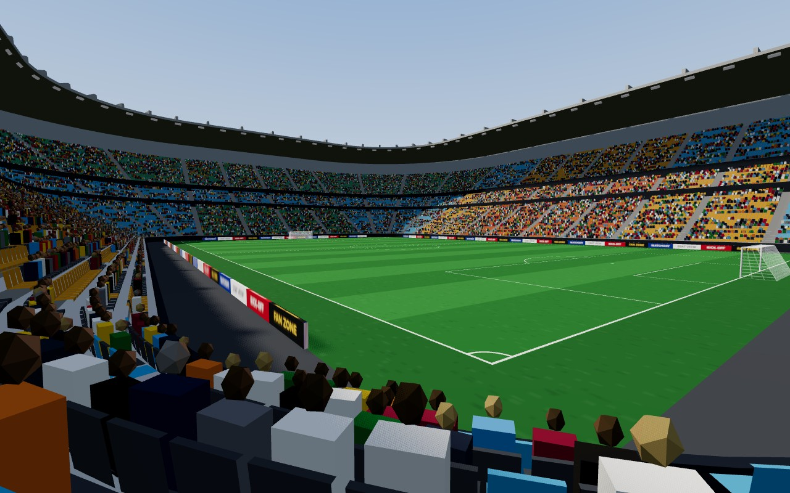

# Stadium Seat View: Project Document

A complete record of the project: what it is, how it is built, how it was developed and verified, what is still approximate, and what it would take to turn it into a product.

For day-to-day use, see [README.md](README.md) (run instructions, config reference, plugging in a real stadium). For full test data, see [docs/VERIFICATION.md](docs/VERIFICATION.md).

---

## 1. Summary

Stadium Seat View is a web app that lets football fans preview the view from any seat in a stadium before buying a ticket. It renders a procedurally generated stadium in 3D in the browser. Fans can orbit the bowl, click a section, click a seat and fly into a first-person view from that seat. Prices, availability and filters come from a mock ticketing data file.

The generator is driven by a config file per venue. Each stand can have its own tiers, rows, roof and corner shape, and real block names. Besides the generic default stadium, the project includes an approximate model of St James' Park, Newcastle, fitted to public map data and checked against fan seat photos.

| | |
|---|---|
| Stack | Vite 8, TypeScript 7, Three.js 0.187. Plain DOM/CSS UI. No backend, no other runtime libraries |
| Size | About 4,800 lines of TypeScript plus one stylesheet |
| Default stadium | 120 sections (101–140, 201–240, 301–340), 54,448 seats, cantilevered roof |
| Venues | `default`, `four-stands` (example of mixed stands), `st-james-park` (approximate, 53,317 seats) |
| Tickets | 4 price categories, 34,963 seats sold (64%), deterministic mock data |
| Output | Static site (`dist/`), about 670 KB of JavaScript (174 KB compressed) plus 1.9 MB of JSON data |
| Repository | https://github.com/whoistorres/stadium-seat-view (MIT licence; the St James' Park config is under the ODbL, see that file) |


---

## 2. Status at a glance

**Done**
- All six planned phases: stadium, seats and selection, seat-view camera, ticketing layer, realism and mobile, documentation
- Sightlines designed so every seat sees the near touchline over the head in front: minimum 84 mm clearance, median 115 mm
- Camera never enters the building: 0 violations across 11,223 checked animation frames and 96 forced-camera tests
- 60 fps on High on an Intel Iris Xe at window sizes up to 2560×1440, with adaptive resolution on large windows
- Keyboard-only use, accessible names and WCAG AA colour contrast checked; issues found were fixed
- README, verification report and screenshots
- Config-driven venues: per-stand overrides, any number of tiers, round or square corners, overhanging tiers, real block names and lettered rows
- St James' Park modelled approximately and checked against fan seat photos (see section 8)

**Known gaps**
- St James' Park is approximate: rakes, roof sizes and the upper-tier overhang are fitted estimates. Its blocks follow the club's 2026-27 block map and its rows and seat numbers follow fan photo tags, but the East Stand and the Gallowgate West Corner have the wrong number of rows (see Verification)
- Ticketing is mock data with no real ticketing-system integration
- A full-screen 4K window on this laptop's GPU reaches about 53 fps on High in upper-tier views (Low holds 60)
- Not tested on:
  - real phones
  - other GPUs
  - Firefox or Safari
  - screens faster than 60 Hz
  - with a screen reader

---

## 3. How to run

Requires Node.js 20+ (developed on Node 24).

```bash
npm install
npm run dev          # http://localhost:5173
npm run build        # type-check + static build into dist/
npm run preview      # serve dist/
npm test             # Vitest: generators, tickets, adaptive resolution
```

GitHub Actions ([`.github/workflows/ci.yml`](.github/workflows/ci.yml)) runs the type check, the tests and a build on every push to `main` and every pull request, and fails if the build would change the committed `public/data` files.

Starting the dev server or a build regenerates `public/data/stadium.json` and `public/data/tickets.json` from a config. `STADIUM_CONFIG=<name>` picks one from [`src/config/index.ts`](src/config/index.ts) (default: [`src/config/stadiumConfig.ts`](src/config/stadiumConfig.ts)); in PowerShell, `$env:STADIUM_CONFIG='st-james-park'; npm run dev`. Only the default config is written to `public/data`; any other is served from memory in dev and written to `dist/data` in a build, so a venue preview can't leave its data behind to be committed. Set `STADIUM_DATA=external` to keep hand-supplied data instead.

A specific seat can be linked directly, for example `http://localhost:5173/#S-324-R22-N09`.

---

## 4. Features

### Stadium model (procedural)
- **Pitch:** 105 × 68 m, with full markings to the Laws of the Game:
  - halfway line and centre circle
  - penalty areas, goal areas, penalty spots and arcs
  - corner arcs
- **Around the pitch:** goals with nets, mowing stripes, a surrounding track and advertising boards.
- **Bowl:** three tiers in a rounded-rectangle shape.
  - Lower tier: 24 rows. Middle tier: 10 rows. Upper tier: 22 rows.
  - Each tier has 8 sections per sideline, 4 per end and 4 per corner.
  - Sidelines, ends and corners are distinct zones.
- **Sightline-designed rake:** each row's step height is calculated from a target sightline clearance, so the steps get slightly steeper towards the back. Rakes are about 24°→31° (lower), 31°→32° (middle) and 34°→35° (upper), capped at 35°.
- **Roof:** a cantilevered ring reaching 30 m in over the seats, with girders and a row of floodlight fixtures. It clips the top of the view from upper rows.
- **Building:** generic walls between tiers, walkways, a back wall and an outer facade.
- **Seats:** 54,448 of them, drawn as one instanced mesh per section. Each chair is 10 triangles up close and 4 far away.

### Venue configs
- **Per-stand overrides:** the bowl has eight pieces (four sides, four corners). Each can have its own tiers and rows, sections, roof (or none), concourse depth and distance from the pitch, or be left empty.
- **Any number of tiers**, numbered front to back.
- **Corners:** round (rows curve round) or square (rows run straight on and meet at the diagonal, as in a filled-in corner).
- **Overhanging tiers:** a negative `setback` hangs a tier out over the back rows of the tier below. Its underside rises going back at the rake of the tier's first rows, as a real stepped soffit does, and every row beneath must keep 2.4 m of headroom.
- **Real names:** `blocks` gives a stand's real block names in place of numbers; `rowLabels` gives lettered rows (A–Z, then AA, BB…) or any list; `seatNumbers` numbers seats across a whole stand instead of per block, from either end and from any first number.
- **Sightlines per stand (optional):** `bowl.sightlines: 'stand'` designs each stand's rake for its own distance to the pitch, for grounds of separate stands. The default shares one distance so matching stands join seamlessly.
- **Outside:** each stand's outer wall can be concrete, glass (curtain wall, windows lit in the evening), cladding panels or brick, drawn in flat colours for the overview, with a paved apron round the building.
- **Bands of blocks:** a tier's rows can be split into bands of blocks stacked front to back (`bands`), each with its own block names and, if needed, its own row labels, for stands where, say, L1 blocks sit in front of L2 blocks. Geometry and sightlines are unchanged; row numbers start again in each band.
- **Seat numbers round a corner:** `seatNumbers.continueFrom` carries a stand's seat numbers on from its neighbour's, row by row, as St James' Park's Level 7 runs from the Milburn Stand round to the Leazes End.
- **St James' Park:** Milburn Stand and Leazes End two-tiered with the upper tier wrapping their corner under one big roof, East Stand single-tiered, Gallowgate End split by a walkway, all corners filled square. Every block named as on the club's 2026-27 block map, with the stand prefix used on fan photo tags and ticket sites (MSL1A, LSL7F, ESA, GSQ, LWCL7C, LECB…), in bands where the map stacks them. Rows lettered without I or O, doubled (AA, BB…) at the front of the lowest levels, and seats numbered right to left along each band, all from 362 fan photos tagged with block, row and seat. Pitch gaps and stand depths come from the OpenStreetMap building outline. Outside: glazed Milburn/Leazes backs, brick East Stand, clad Gallowgate (chosen to read as the ground from above, not surveyed).

### Camera
- **Orbit mode:**
  - rotate, zoom and pan with mouse or touch
  - limits on how far the camera can go
  - automatically lifted over the stands and roof, so it can't enter the building
- **Section view:** clicking a section flies the camera to frame it, and dims the other sections.
- **Seat view:**
  - first-person camera 1.2 m above the step the seat stands on
  - initially aimed at the nearest part of the pitch (the centre of the pitch-wide square closest to the seat), so corner and end seats face their own end the way a fan does; the Centre spot button or C switches to the centre spot
  - drag or W/A/S/D to look around, up to ±110° left/right
  - field of view 60–100° by slider, mouse wheel or +/−
  - R recentres the view
- **Animated flights:** the camera arcs in over the roof and drops into the bowl, entering the seat along its own line of sight. Short moves to a neighbouring seat are quick hops that arc upwards so they clear the walls at the front of each tier.
- **Portrait phones:** the FOV setting applies to the screen's width, so the whole pitch fits (vertical FOV capped at 105°).

### Seat selection
- Hover tooltip: section, row, seat number, category, price and status.
- Click a section to zoom in, then click a seat to fly into its view.
- Section → Row → Seat dropdowns do the same without precise clicking. They show free-seat counts and disable sold seats.
- Keys:
  - arrow keys move to the adjacent seat or row, crossing aisles, sections and tiers, and skipping sold or filtered seats
  - Esc returns to the overview
- On-screen buttons for the same seat moves, for touch and mouse-only users.
- Seat IDs are stable and deterministic, for example `S-214-R12-N07`. The selected seat is kept in the URL, so links can be shared and reloaded.

### Ticketing layer (mock)
- **Four price categories:**

  | Category | Base price | Seat prices (default stadium) | Pattern |
  |---|---|---|---|
  | A Premium | €145 | €125–170 | solid |
  | B Central | €95 | €75–110 | stripes |
  | C Standard | €65 | €50–75 | dots |
  | D Value | €40 | €35–45 | crosshatch |

  Colours come from a palette designed to stay distinguishable for colour-blind viewers. Each category also has a letter and a pattern, so colour is never the only cue.
- **Per-seat prices:** the category is the price zone; each seat has its own price, stored as runs of `[price, seats]` along each row (one run per row for per-row pricing). The mock prices go by row (the first rows cheaper, the middle of a tier dearest, the back of the top tier cheaper) and by position (near halfway dearer), in €5 steps. The legend, dropdowns and tooltips show price ranges; seat card, seat dropdown and seat tooltip show the seat's own price.
- **3D colouring:** available seats show their category colour, sold seats are grey, and seats outside the filters fade, seat by seat.
- **Section tags:** a floating "214 C" tag on the front wall of each section, fading in as the camera gets closer.
- **Legend and filters:** the legend doubles as the category filter. There are min/max price sliders in €5 steps across every seat price, live counts of matching free seats, a Reset button and a section-tag toggle.
- **Sold or filtered seats** can't be selected by click, dropdown or arrow keys. Clicking one shows the reason, which also works on touch screens.
- **Seat card:** shows the seat's details, a "View from this seat" button and a "Select seat" button. Select stores the seat in the app's state; there is no checkout.
- **View notes:** the seat card says what limits the view, worked out from the model: sightline clearance over the head in front (or the front wall, for a tier's front row; for the first row of a band of blocks further back, the head in front is in the last row of the band in front) rated against the 60/90/120 mm guidance; whether the seat is under the roof or the tier above, and how high you can see before its edge; distance to the pitch and centre spot and eye height.

### Realism
- **Day:** a gradient sky, distance fog, and sun shadows from the roof and stands onto the seats and pitch. Shadows are drawn once and redrawn only when lighting changes.
- **Evening:** a dark sky, an overhead white light standing in for the floodlights, four corner spotlights, glowing roof fixtures, brighter ad boards and a darkened building exterior.
- **Crowd:** 33,000+ seated figures, one on every sold seat.
  - Team colours from the config: home kits (plain or vertical stripes, drawn in the shader), an away end in the away kit, and about 4 in 10 fans in dark coats. A generic mix when the config has none. St James' Park: black-and-white stripes; away fans across the whole straight Leazes Level 7 (blocks LL7F–LL7M and L7F–L7M, 4,902 model seats), as the club's block map marks it. The usual league allocation is up to about 3,000.
  - Faces from the front and hair from behind.
  - Slight random turn and size for each figure.
  - Two detail levels.
  - The figure on the camera's own seat is removed.
- **Stadium details:**
  - Aisle stairs between neighbouring sections, two steps per row with yellow nosings, found from the seat rows.
  - Tunnel mouths at the top of each aisle where the wall there is tall enough: under an overhanging tier, in the front wall of a tier above a walkway, or in the back wall of the top tier.
  - Scoreboards on the front of a stand's roof (or its back wall), showing a lit generic scoreline by day and night. St James' Park has three, for 2026–27: Gallowgate End (confirmed in the club's Fan Advisory Board minutes), Strawberry Corner and Leazes End (press reports of the same meeting). Positions along each stand and sizes are placeholders.
  - Team dugouts by the halfway line with clear canopies, backing onto the advertising boards (which stop either side of them). The seat card says when a dugout hides part of the near touchline.

### Quality and performance
- **Low/High switch:**

  | | High | Low |
  |---|---|---|
  | Shadows | on | off |
  | Crowd | every sold seat | 40% of sold seats |
  | Detailed crowd figures within | 45 m | 25 m |
  | Pixel ratio | up to 1.5× | 1× |

  Touch screens and narrow windows start on Low.
- **Adaptive resolution:** aims for the display's refresh rate (measured from the gaps between frames). When the frame rate stays below it, it renders fewer pixels, one step at a time.
  - At 60 Hz: floor of 0.7× on ordinary windows, about 1080p-equivalent sharpness on very large ones.
  - Above 60 Hz: floor of 85%. If that still can't keep up, it aims for a sharp 60 fps at full resolution instead, and retries the display rate later.
  - It steps back up once performance is steady, waiting longer each time a step back up (or a retry of the display rate) has to be undone.
  - The fps readout shows when resolution is reduced, for example "60 fps · 76% res", or "60 fps target (display 144 Hz)" when it has settled for 60.
- **Loading screen** with progress steps, and an FPS readout in the top bar.

### UI and accessibility
- **Desktop:** a side panel.
- **Mobile:** a bottom sheet that shows the current seat and price, and folds away when you enter a seat view.
- **Labels:** every input has a label, the time and quality switches are labelled groups, and buttons have descriptive names.
- **Keyboard:** everything works without a mouse, focus rings are visible, and focus is kept when controls hide or become disabled.
- **Contrast:** all text meets WCAG AA (4.5:1).

---

## 5. Architecture

### Module map

```
plugins/stadiumDataPlugin.ts   Vite plugin: config -> data at startup (default: public/data/*.json; others: served from memory)
src/
  config/index.ts              Named configs that STADIUM_CONFIG picks from
  config/stadiumConfig.ts      Default generic stadium
  config/examples/, venues/    Four-stands example; St James' Park (approximate)
  data/                        No three.js in the generators
    types.ts                   StadiumConfig, StadiumData, TicketData
    generateStadium.ts         config -> StadiumData (pure, deterministic; sightline-designed rake)
    generateTickets.ts         StadiumData -> TicketData (seeded mock)
    bowlPath.ts                bowl geometry (round or square corners), shared by generator and renderer
    overhang.ts                where a tier hangs over the one below; shared by generator, renderer, camera
    viewNotes.ts               per-seat view notes for the seat card: clearance, cover, distances, dugouts
    envelope.ts                stand and roof heights for keeping the camera outside the building
    loadData.ts                load + validate stadium.json; seat indexing; neighbour search
    tickets.ts                 load + validate tickets.json; availability and filter lookups
    seatId.ts                  "S-214-R12-N07" format and parse
  state/store.ts, actions.ts   Tiny pub/sub store; every user intent goes through actions
  camera/cameraController.ts   Orbit, section and seat views; animated flights
  interaction/                 Picking (section proxies + seat raycast), pointer, keyboard
  scene/                       Pitch, stands, seats, roof, crowd, labels, lighting, quality;
                               aisles.ts (stairs, tunnel mouths), details.ts (scoreboards, dugouts)
  ui/                          Panel, legend/filters, overlay, tooltip, HUD, styles
tests/                         Vitest: generators, tickets, adaptive resolution (simulated GPU)
.github/workflows/ci.yml       Type check, tests, build and a public/data check on every push and PR
```

### Data flow

```
config (STADIUM_CONFIG) --(Vite plugin at startup)--> stadium.json + tickets.json
                                                       |
                                     fetched + validated at page load
                                                       |
                Stadium / Tickets indexes --> scene builders (steps, seats, crowd, labels)
                                                       |
   pointer / keyboard / panel --> actions --> store --> seat colours, panel, overlay, camera
```

The renderer reads only the JSON, never the config. Swapping in a real stadium is a data change, not a code change.

### Key design decisions

| Decision | Why |
|---|---|
| Seat data as plain JSON, stored as `[seat, x, y, z, yaw]` tuples | Swappable for a real venue; compact; IDs derived from the numbers, not array positions |
| Steps under the seats built from the seat rows themselves | They always match whatever seat data is loaded |
| One InstancedMesh per section, not one for all 54k seats | Off-screen sections are skipped cheaply, recolouring touches one section at a time, and seat picking only tests one section |
| Invisible low-poly sheet over each section for picking | Testing 120 sheets is far cheaper than testing 54k seats; the exact seat is found afterwards within that section only |
| Two detail levels for seats (10/4 triangles) and crowd (30/4) | Cut the triangle count from 1.3 M to about 0.25–0.5 M |
| Shadows drawn once, redrawn only when lighting changes | Nothing that casts a shadow moves, so redrawing every frame would be wasted |
| Camera flights travel above the building, then enter along the seat's own line of sight | The line of sight is the one path guaranteed to be clear under the roof |
| Step heights solved from a sightline target (standard stadium design method) | Guarantees views over heads instead of hoping a fixed rake works |
| Lower resolution rather than switching shadows off when slow | Measured as the effective fix (the slow views were limited by pixel count), and it avoids the lighting visibly popping |
| No state or animation library | The store is about 40 lines and the camera easing is one function; fewer dependencies |

---

## 6. Data model and configuration

Full reference in [README.md](README.md#stadium-config). In short:

- **Config (`StadiumConfig`):**
  - pitch size and run-off distances
  - corner radius and corner shape (round or square), seat spacing, aisle width
  - sections per zone
  - per tier: rows, row depth, minimum rake, sightline target (`cValue`), setback (negative = overhang), lift, front-wall height, row labels
  - roof and facade dimensions
  - eye height
  - per stand (`stands`): name, its own tiers and their changes, sections or real `blocks`, roof, concourse depth, run-off, corner shape
- **`stadium.json`:** pitch size, seat-spacing hints, an optional generic `shell` (the walls and roof), and `sections[]`, each with rows of `[seat number, x, y, z, yaw]`. Coordinates: origin at the centre spot, X along the pitch, Z across, Y up, metres.
- **`tickets.json`:** the price categories, a category per section, and the sold seat keys per section.
- **Seat IDs:** `S-{section}-R{row:2}-N{seat:2}`. The section is the block name where the config gives one (`S-LSL1C-R06-N11`); the row is always its number, even when it is labelled with a letter.

The README includes a tested CSV → `stadium.json` converter: it round-tripped all 54,448 seats identically.

---

## 7. Development history

The work followed an agreed plan in six phases, stopping after each for review.

| Phase | Delivered | Problems found and fixed |
|---|---|---|
| 1. Scaffold, pitch, empty bowl | Vite/TS/three setup, config, data generator, pitch with markings, goals, boards, stepped stands, orbit camera | Data file not written early enough for the first page load; the config loader needed explicit `.ts` import extensions |
| 2. Seats and selection | Instanced seats, section picking, tooltip, click to zoom/select, dropdowns, link to selected seat | 24-triangle chairs made 1.3 M triangles: rebuilt at 10/4 triangles with two detail levels; hidden Back button still showing; Esc guard bug |
| 3. Seat-view camera | Animated flights, drag/WASD look, FOV slider, arrow-key seat moves, seat toolbar | Short hops could pass through the walls at the front of each tier (now arc upwards); pasted seat links ignored in the same tab |
| 4. Ticketing layer | Seeded `tickets.json`, category colours, legend/filters, sold seats blocked, seat card, "Select seat", section tags | Price slider steps couldn't reach €145; silent failure when no seat in that direction; section tags covered the seats when zoomed in; misleading green "Sold" button |
| 5. Realism, crowd, mobile | Roof, sky, shadows, day/evening, crowd, Low/High, loading steps, mobile bottom sheet | Loading hung in background tabs; a shadow type removed in three 0.187; heads looked like big brown cubes; building exterior looked sunlit at night; mobile labels showing; narrow pitch view in portrait |
| 6. README and verification | README, verification report, screenshots, benchmark helper | See section 8: poor lower-tier sightlines, front row too close to the corner flag, slow frame rate on large windows, keyboard focus and contrast issues |

After the six phases the project went under git and onto GitHub, and work moved to real venues:

| Date | Commit | Delivered |
|---|---|---|
| 2026-11-13 | Per-stand config; any number of tiers; MIT licence | Each of the eight bowl pieces configurable; tiers no longer fixed at three |
| 2026-11-13 | St James' Park venue | Approximate model from the OpenStreetMap outline and published facts |
| 2026-11-18 | Fit to fan seat photos | Camera fitted to pitch markings in fan photos; Level 7 raised to match a row F photo, Gallowgate split by its walkway, Gallowgate roof made to fall towards the pitch (and seat flights kept under such roofs) |
| 2026-11-18 | Square corners | Filled-in corners; corner seat flights aim at the corner's centre so they never cross the next stand |
| 2026-11-18 | Block names and lettered rows | Real block names per stand and tier; row letters shown everywhere in the UI |
| 2026-11-20 | Overhanging tiers | Negative setback with underside, headroom check and camera handling; St James' Park upper tier given an estimated 4 m overhang |
| 2026-11-20 | Sightlines per stand; outside of the stadium | Optional per-stand rake design (used by the four-stands example; St James' Park keeps the shared design so its Milburn–Leazes wrap and photo fit hold); facade styles and a paved apron |
| 2026-11-26 | View notes; seat numbering | Seat card explains what limits each seat's view; seats can be numbered across a whole stand, from either end, ready for the St James' Park block map |
| 2026-11-26 | Seat view aim; stadium details | Seat view faces the nearest part of the pitch, with a centre-spot toggle; aisle stairs, tunnel mouths, scoreboards and dugouts. The dugouts' back wall was made clear above a low panel after it blocked the view from the front rows behind them |
| 2026-11-26 | Per-seat pricing; team colours | Seat prices vary by row and position within each price zone, and every filter, count and colour works per seat; the crowd wears home and away kits, with stripes |
| 2026-11-26 | Venue previews kept out of `public/data` | Twice a St James' Park preview (once relaunched by the desktop app after being stopped) overwrote the committed default data just before a commit; caught before pushing. Non-default configs are now served from memory instead of written to disk |
| 2026-11-26 | Tests and CI; refresh-rate matching | 68 Vitest tests and a GitHub Actions workflow. Adaptive resolution now aims for the display's refresh rate, accepting at most a 15% drop in resolution before settling for a sharp 60 fps. A first simulation sat at 138 fps on a 144 Hz display, inside a 4% margin and never adjusting, though that means a dropped frame every fifth of a second; the margin became 3% |
| 2026-11-26 | St James' Park research applied | Research (via Gemini) checked against the model. Dugouts and away end already matched. Screens moved from the two ends to the Leazes End, Milburn Stand and Strawberry Corner. A fourth away section was planned to reach about 3,000 seats, but each section is 874 seats, so it would have made 3,496; the away end stays at three. Third-party block codes (MSL1A–I, ESA–M, GSA–V…) were not applied: their order and tiers are unknown, and their counts don't match the model's sections. One press source couldn't be opened (HTTP 403). Checking in the browser also showed the new refresh-rate detection reading a 60 Hz screen as 64 Hz (frame-timing jitter) and wrongly settling for 60; it now averages the gaps near the median and needs two seconds in a row to agree on a common rate |
| 2026-11-26 | St James' Park rows and seat numbers re-fit | 362 fan photos on A View From My Seat, tagged with block, row and seat, gave real row letters (no I or O; doubled at the front of the lowest levels), the corner prefixes (LWC, LEC, GEC, GWC) and seat numbers running right to left along each band, Level 7 in one run round the Milburn–Leazes corner. They also showed the model's Milburn/Leazes tiers were the wrong depth: Level 7 is about 28 rows (31 in the Leazes End), not 46, and the lower tier about 51, not 32. With the bands in place, the Leazes Level 7 photo's row F had drifted 5 m too high. The re-fit puts real L7 row F back where the photo was taken, which needs Level 7 to hang about 16 m out over the lower tier. With the old flat underside that left no headroom for a lower tier with useful sightlines, so overhang undersides now rise with the tier above, as real ones do. The lower tier's sightline target dropped to 20 mm so the seats under Level 7 keep the far side of the pitch. The council's planning portal could not be reached for the overhang (its old address no longer exists and its servers didn't answer). Camera flights found a stray tunnel mouth where the Leazes lower tier meets the Leazes East Corner: their rows happen to sit at the same heights for a while, so an aisle was built across the join; aisles between two stands now need matching rows all the way up |
| 2026-11-26 | St James' Park blocks from the club map | The club's 2026-27 block map (its "Seating Categories" PDF) settled what the research could not. Tiers can now be split into bands of blocks stacked front to back; every block on the map is a section, with the ticket sites' stand prefix. Away fans cover the whole straight Leazes Level 7 (12 blocks, 4,902 seats), as the map marks. The club's own minutes confirm a Gallowgate screen and no source was found for the Milburn one, so the screens are Gallowgate End, Strawberry Corner and Leazes End. Model capacity rose from 52,162 to 53,804 (club: 52,719) because the real blocks are wider, with fewer aisles. Checking showed the first row of a band further back had no sightline note; it is now measured over the last row of the band in front. The browser's PDF viewer offered a save dialog instead of showing the map, and that saved a copy into the project folder; it is kept out of git, and the map's facts (not the file) are in `docs/research/st-james-park.md` |

Mid-project the files moved from a temporary workspace into `C:\Users\berni\stadium project`. The stylesheet had to be copied across by hand, and the dev server had to be started from the new folder by hand because the preview tool kept using the old one.

---

## 8. Verification results

### Geometry and sightlines (every seat, scripted)
- Seat-view eye: exactly 1.2 m above its floor, at least 5.3 m below the roof.
- Front row: at least 6.7 m from the pitch (corners), 8 m along the sidelines, 9 m behind the goals.
- **Sightline over the head in front:** minimum 84 mm, median 115 mm, 0 seats below 60 mm. Guidance treats 60 mm as acceptable, 90 mm as good and 120 mm as excellent.
- **Before fixes:** with a constant 20° lower-tier rake, the median was 35 mm and the worst −168 mm, so many fans could not see the near touchline. A 22 m corner radius also put the corner front row 2.9 m from the corner flag. Both were fixed: step heights solved from a 90 mm target, and a 14 m corner radius.

### Camera never inside the building
- 240 animated flights, 11,223 frames checked against the stands, roof and concourse: 0 violations.
- 96 tests forcing the orbit camera low into the building: 0 violations.
- Limit: these tests use a simplified model of the building, not the actual triangles.

### St James' Park
- **Photo fits:** camera position and angles fitted to pitch-marking pixels in fan photos.
  - Leazes Level 7 row F: the photo fit put the camera 92.6 m from the centre spot, eye 27.94 m up. Real L7 row F is the 14th row of Level 7 (behind 3 L6 and 5 LL7 rows); the model puts it at 92.6 m, eye 28.06 m.
  - Gallowgate roof front edge: within 1 px of the photo.
  - Gallowgate block GS-Q row A: fits a model seat in the Gallowgate–Milburn corner to 3.6 px (27.9 px before the square corners).
- **Capacity:** model 53,317; the club gives 52,719 (August 2026). The model has no executive box levels or media seats.
- **Blocks:** every block on the club's map is present once, in the map's order; tests pin the Milburn lower order (no L1E at the tunnel), the away end and the singing section beside it.
- **Rows and seat numbers (fan photo tags):** each band has the rows the tags show, where the stand's shape allows, and tests pin the lettering (no I or O; Leazes L1 running on from FF to GG). Model seat numbers land close to the tags in most blocks: Leazes L1F 96–114 (tag 113), L2Q 65–80 (tags 72–91), Milburn L1D 73–96 (tags 75–91), Leazes West Corner L7E 299–388 (tags 339–398). Along Level 7 the model runs about 15% short by the Leazes End (L7M 429–447 at row F against tags of 532–566), because it fits fewer seats in each row than the real stand.
- **Level 7 height:** a fan in LS-L7H counts 186 steps up to row W, roughly 33–35 m; the model's row W is 35.3 m above the pitch (the old 46-row tier put it about 46 m up).
- **Shape that doesn't match yet:** East Stand tags reach row R in blocks A–F and row W in H–M, 37 rows, against the model's 28. The Gallowgate West Corner's back blocks have 38 rows in the model against tags up to Y (23). Milburn L4 tags reach QQ (15) against 13 modelled. The GS-Q row A photo fitted a seat in the model's Gallowgate–Milburn corner; the club map puts block Q in the Gallowgate End right next to that corner.
- **Camera flights:** square corners 0 hits in 1,004 flights; overhang 0 hits in 930 flights across every section, plus 552 flights from the rows under a deliberately low overhang. Every frame-to-frame segment is raycast against the real triangles. Scoreboards and dugouts: 0 hits in 840 flights (in and out of 420 seats, including every third seat in the six Milburn rows behind the dugouts), each frame step tested against the objects' bounding boxes.
- **Sightlines per stand** (clearance over the head in front to the nearest point of the pitch, median):

  | Stand | Lower | Upper |
  |---|---|---|
  | Milburn | 20 mm | −25 mm |
  | Leazes | 45 mm | 0 mm |
  | Leazes West Corner | 90 mm | 91 mm |
  | East | 60 mm | — |
  | Gallowgate | 42 mm | 38 mm |

  The Milburn/Leazes lower tier is designed for 20 mm, not 60. With Level 7 fixed by the photo, a 60 mm lower tier would rise above Level 7's front edge, and about 4,500 seats under it would lose the far side of the pitch; at 20 mm, 120 seats come within 2° of losing it. Under Level 7 (9,712 seats) you can see at least 6.5° below level and typically 12–22° above it. Level 7 is at the 35° rake cap; it is better than before the re-fit (Milburn −108, Leazes −80 mm) because it is shorter and further forward.
- **View notes** (clearance over the nearest head in front, to the nearest point of the pitch, every seat, after the row re-fit): 6,442 seats below 0 mm, 29,453 at 0–60, 7,020 at 60–90, 2,177 at 90–120 and 8,225 at 120 mm or more (before: 17,821 below 0). The negative ones: 5,376 in Milburn Level 7, 729 in the Leazes West Corner's Level 7, 120 in Leazes Level 7, 179 in the Gallowgate upper tier and its Milburn corner, and 38 lower-tier corner seats near the diagonal of a square corner, where the nearest head in front sits on the other leg. The default stadium has every seat at 60 mm or more.
- **Screens with the club's blocks:** 196 camera flights, in and out of the front and back row of every Gallowgate, Gallowgate-corner and Leazes upper section, 14,032 frame steps against the three screens' bounding boxes (plus 0.3 m): 0 hits.
- **Screens (2026–27 positions):** 344 camera flights, in and out of the front and back row of every section, 49,055 frame steps tested against the three screens' bounding boxes (plus 0.3 m): 0 hits.
- **Per-seat prices:** with the price filter at 150 to 170 euros, the legend count (1,441 free seats) matches a seat-by-seat count, and no seat outside that window can be selected.
- **Camera flights after the row re-fit:** 1,344 flights in and out of the front, middle and back row (both end seats) of every Milburn, Leazes West Corner and Leazes section, 96,768 frame steps raycast against the real triangles. Two hit a stray tunnel mouth where the Leazes lower tier meets the Leazes East Corner (see history); after the fix, 600 flights over every Leazes and Leazes East Corner section (43,200 frame steps) hit nothing.
- **Not checkable yet:** the size of the upper-tier overhang (no photo or plan shows it; the photo fit and the row counts put it at about 16 m), and the East Stand and Milburn lower tier against photos.

### Performance (Intel Iris Xe, 60 Hz, Chromium, visible window)

| Window | High | Low |
|---|---|---|
| 1280×800 | 60 fps in every view, full resolution | 60 fps |
| 1920×1080 | 60 fps (adaptive resolution in upper-tier views) | 60 fps |
| 2560×1440 | 60 fps, settles at 0.7× resolution in about 13 s | — |
| 3840×2160 (4K) | about 53 fps in upper-tier views at the 1080p-sharpness floor | 60 fps |
| High-DPI loads (1.5× pixel ratio at 1440×900 and 1920×1080) | 60 fps | — |

Camera flights and switching settings held 60 fps with no hitch.

Early measurements taken while the browser pane was hidden were discarded: the browser throttled the hidden page to between 2 and 30 frames per second.

### Keyboard and accessibility
- Logical tab order, visible focus everywhere, clean accessible names for every control.
- Picking a seat fully by keyboard works.
- **Fixed:** Esc didn't work while focus was in a dropdown, and focus was lost after leaving a seat view.

### Colour contrast
- 94 text styles measured: 0 failures at WCAG AA, including text over the 3D view tested against both a white and a black scene behind.
- **Fixed:** category letters on the patterned badges could sit on a pattern line (worst 3.4:1). They now sit on a solid disc: 5.4–9.3:1.

### Screenshots

| | |
|---|---|
| Lower tier, corner (110 R6) |  |
| Upper tier, sideline (324 R14) |  |
| Upper back row under the roof (324 R22) |  |
| Evening |  |
| Phone |  |

---

## 9. Known limitations

**Model**
- A rectangle with round or square corners; each stand is one straight piece. Missing:
  - handrails, and tunnel mouths in lower tiers with only a low wall behind them (real ones come up through the seats, which would change the seat data)
  - corner gaps
  - a players' tunnel
- Rows have constant depth.
- Scoreboard and dugout positions are generic defaults (end stands, north touchline), not surveyed. St James' Park: dugouts on the Milburn side match published guides. Its screens are on the Gallowgate End (club minutes), Strawberry Corner and Leazes End (press reports); where along each stand and how big is not known, and the minutes say the Gallowgate screen faces "outward", which is modelled as facing the pitch. The club's four smaller in-bowl replay screens (August 2026) are not modelled.
- Sightline checks assume everyone's eye is 1.2 m above their floor and aim at the nearest point of the pitch. Tall people and standing fans are not modelled.
- **St James' Park:** the box levels between its tiers are not modelled, the overhang is an estimate, and row counts are the furthest-back rows fan photos show (the real count can be a little higher). The East Stand is 9 rows short and the Gallowgate West Corner's back blocks 15 rows too deep. The Milburn L2 and L4 lettering is a guess (tags mix single and doubled letters). The Leazes West Corner's lower tier starts 12 rows back, behind a front wall, because it has no L1 blocks; that is inferred, not seen. The map's corners are rounded; the model's are square.
- With `shell: null` (a real venue's own building model), the orbit camera no longer has anything stopping it entering the building. That needs reworking for real venues.

**Visuals**
- **Crowd:** low-poly box torsos with simple heads, seated and still. Kits are flat colours or vertical stripes only (no hoops, sleeves or badges).
- **Evening lights:** faked with one overhead light plus four spotlights; only the overhead light casts shadows.
- **Shadows:** soft but coarse, about 15 cm per shadow pixel.
- **Large windows:** the image gets softer there, because resolution is lowered to keep the frame rate.

**Seat view**
- Portrait phones use a wide vertical FOV (up to 105°), which adds some edge distortion.

**Ticketing**
- Mock prices follow a simple row-and-position rule, not a real club's price list.
- Mock availability and no checkout. "Your seat" lasts only for the session.

**Untested**
- real displays faster than 60 Hz (the controller is tested only against a simulated 144 Hz display and GPU)
- other GPUs
- real high-DPI monitors (only emulated)
- Firefox and Safari
- real phones and touch gestures
- an actual screen reader

---

## 10. Commercial assessment

Honest view from a big club's side, given during the project.

**As it stands: no.** It is a strong prototype, but a club pays for a preview of *its own* stadium, wired into *its own* ticketing. Neither exists yet.

**Where a club would pay:**
- **New stadium or major renovation:** selling seats before the stand exists, the strongest case.
- **Hospitality and premium seating:** high-value sales where the view justifies the price.
- **Seat moves, upgrades and official resale:** fewer complaints and refunds.

Sold-out regular seats at top clubs gain little, because demand already exceeds supply.

**Competition:** 360° photos per section (cheap, photo-real) and free fan seat-photo sites. 3D wins on covering every seat and on stands that are not built yet.

**What a club would require before buying:**
1. An accurate model of its own stadium, built from architects' drawings or a laser scan, and checked against photos from real seats.
2. Live availability and checkout through its existing ticketing system.
3. Good performance on cheap Android phones over 4G.
4. Reliability when tickets go on sale and traffic spikes.
5. Compliance:
   - the European Accessibility Act
   - GDPR
   - a penetration test
   - an outside accessibility audit
6. The club's branding, with room for sponsors.
7. Proof it works, such as an A/B test on conversion or complaints.
8. A support contract and a price that beats photography.

**Where the value is:** the 3D viewer itself is easy to copy. The defensible parts are accurate venue models and ticketing integrations. The realistic route to market:
- clubs building or renovating stadiums, or
- a partnership with a ticketing platform (Ticketmaster, Eventim, SECUTIX and similar),

rather than selling a standalone viewer to top clubs.

---

## 11. Suggested next steps

**Current roadmap**
1. St James' Park East Stand: re-fit to its 37 rows (A–F to row R, H–M to row W, the "East Stand Upper"), probably as two tiers, and the Gallowgate West Corner's back blocks to about 23 rows.
2. More photo checks: East Stand and Milburn lower tier, and a Leazes West Corner lower-tier photo to confirm its set-back front.
3. Optional: nearby buildings around St James' Park from OpenStreetMap, for context in the overview.

**To make it a product**
1. Model one real stadium end to end, from a CAD/CSV export or a laser scan, and compare the seat views with photos taken from real seats. (St James' Park is a first step from public data.)
2. Build an adapter for one ticketing platform's API: live availability, holds and a hand-off to checkout.
3. Rework camera clearance so it uses the real building model instead of the generic shell.
4. Test on real phones (mid-range Android, iPhone) and in Safari and Firefox. Tune Low for phones.
5. Commission an outside accessibility audit and screen-reader testing.
6. Add privacy-respecting analytics (seat previews leading to purchases) to support an A/B test.

**Quality improvements**
- Handrails, a players' tunnel, and lower-tier tunnel mouths that come up through the seats.
- Higher-refresh-rate support in adaptive resolution (aim for the display's own rate).

---

## 12. File index

| Path | Purpose |
|---|---|
| [README.md](README.md) | Run instructions, controls, config and data reference, real-stadium guide |
| [PROJECT.md](PROJECT.md) | This document |
| [BUSINESS_PLAN.md](BUSINESS_PLAN.md) | Draft plan for taking this to market, including what ticketing platforms need |
| [docs/VERIFICATION.md](docs/VERIFICATION.md) | Full test data: geometry, flights, performance, keyboard, contrast |
| [docs/screenshots/](docs/screenshots/) | Overview, seat views (day and evening), section view, phone layout |
| [LICENSE](LICENSE) | MIT licence |
| [src/config/index.ts](src/config/index.ts) | Named configs (`default`, `four-stands`, `st-james-park`) |
| [src/config/stadiumConfig.ts](src/config/stadiumConfig.ts) | Default generic stadium |
| [src/config/venues/stJamesPark.ts](src/config/venues/stJamesPark.ts) | St James' Park (approximate; ODbL) |
| [plugins/stadiumDataPlugin.ts](plugins/stadiumDataPlugin.ts) | Generates the data files at startup |
| [src/data/](src/data/) | Generators, loaders, types, seat IDs |
| [src/scene/](src/scene/) | Everything drawn in 3D, plus quality and adaptive resolution |
| [src/camera/cameraController.ts](src/camera/cameraController.ts) | Orbit, section and seat views, flights |
| [src/interaction/](src/interaction/) | Picking, pointer and keyboard input |
| [src/state/](src/state/) | Store and actions |
| [src/ui/](src/ui/) | Panel, legend, overlay, tooltip, HUD, styles |
| [public/data/](public/data/) | Generated `stadium.json` and `tickets.json` |
