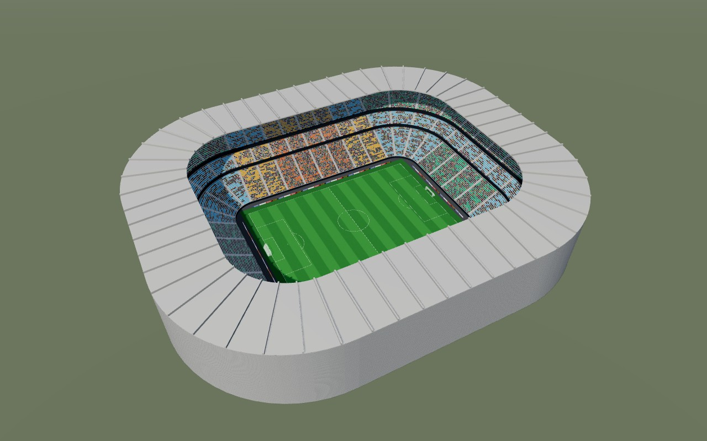
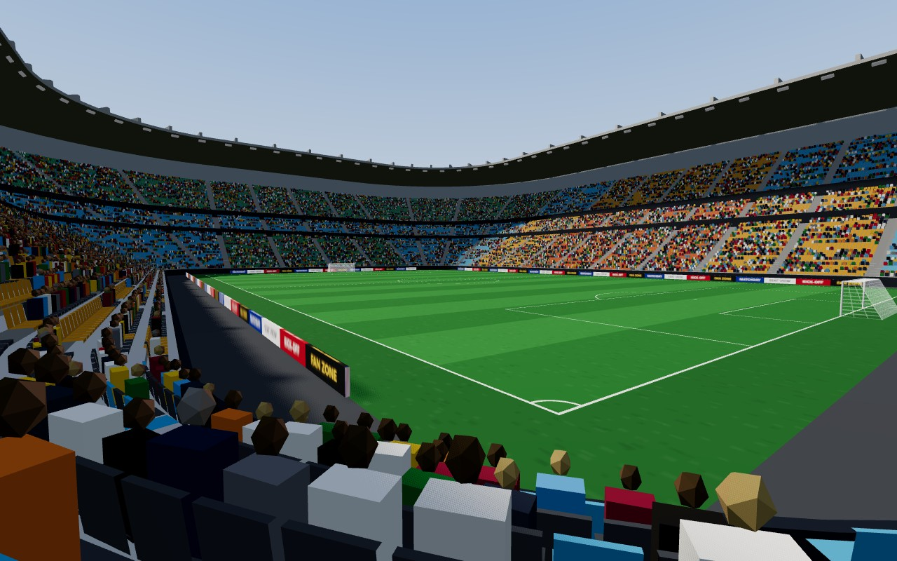
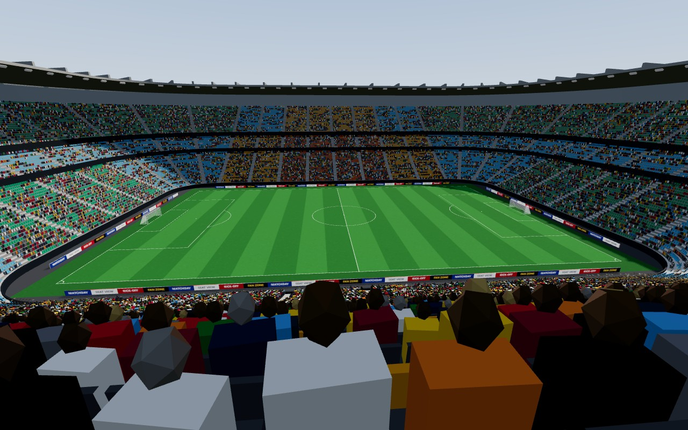
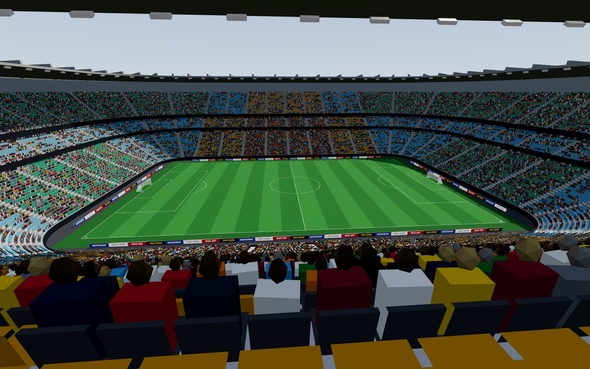
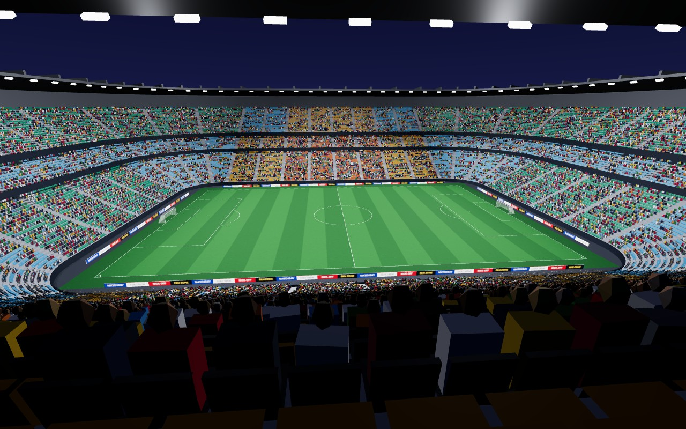
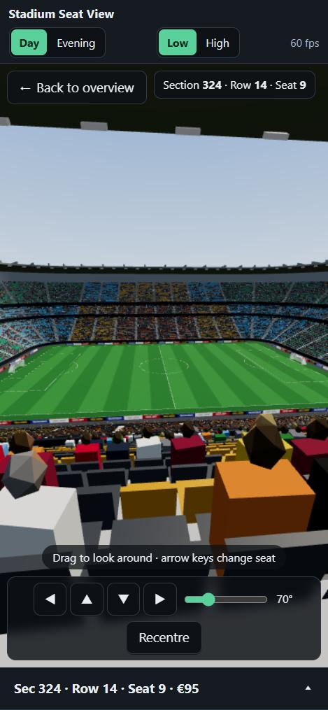

# Stadium Seat View

An interactive 3D soccer stadium where fans can preview the view from any seat before buying a ticket.

- Procedural three-tier bowl: 120 sections (101–140, 201–240, 301–340), 54,448 seats, cantilevered roof
- Rows are raked from a sightline target, so every seat sees the near touchline over the heads in front
- Orbit overview → click a section → click a seat → animated fly-in to a first-person seat view
- Mock ticketing: four price categories, sold seats, category and price filters, "Select seat"
- Day / evening lighting, crowd on sold seats, Low / High quality, desktop and mobile layouts

Stack: Vite + TypeScript + Three.js. Plain DOM/CSS for the UI, no other runtime libraries, no backend.

| Overview | Lower tier, corner (110 R6) | Upper tier, sideline (324 R14) |
|---|---|---|
|  |  |  |
| **Upper back row under the roof (324 R22)** | **Evening** | **Phone** |
|  |  |  |

---

## Run it

Requires Node.js 20 or newer (developed on Node 24).

```bash
npm install
npm run dev          # http://localhost:5173
```

Other scripts:

| Command | What it does |
|---|---|
| `npm run build` | Type-checks, then builds a static site into `dist/` |
| `npm run preview` | Serves `dist/` locally |
| `npm run typecheck` | `tsc --noEmit` only |

The site is fully static: `dist/` can be hosted on any file server or CDN.

Every time the dev server or a build starts, `public/data/stadium.json` and `public/data/tickets.json` are regenerated from [`src/config/stadiumConfig.ts`](src/config/stadiumConfig.ts) (see [Plugging in a real stadium](#plugging-in-a-real-stadium) to stop that).

A seat can be linked directly: `http://localhost:5173/#S-214-R12-N07` opens that seat's view.

## Controls

| | Mouse / keyboard | Touch |
|---|---|---|
| Rotate / zoom / pan (overview) | drag / wheel / right-drag | one finger / pinch / two fingers |
| Zoom into a section | click it | tap it |
| Open a seat view | click a seat | tap a seat |
| Look around (seat view) | drag, or <kbd>W</kbd><kbd>A</kbd><kbd>S</kbd><kbd>D</kbd>; <kbd>R</kbd> recentres | drag |
| Field of view (60–100°) | slider, wheel, <kbd>+</kbd> / <kbd>−</kbd> | slider |
| Adjacent seat | <kbd>←</kbd> <kbd>→</kbd> seat, <kbd>↑</kbd> <kbd>↓</kbd> row behind / in front | on-screen arrows |
| Back to overview | <kbd>Esc</kbd> or the Back button | Back button |

Everything is also reachable without the 3D view: the Section / Row / Seat dropdowns in the side panel (bottom sheet on phones) select any seat.

## Project layout

```
plugins/stadiumDataPlugin.ts   Vite plugin: config -> public/data/*.json at startup
src/
  config/
    stadiumConfig.ts           Default stadium: all dimensions (the only file to edit for a different bowl)
    index.ts                   Named configs that STADIUM_CONFIG can pick from
    examples/fourStands.ts     Example of per-stand overrides
  data/
    types.ts                   StadiumConfig, StadiumData, TicketData types
    generateStadium.ts         config -> StadiumData (pure, deterministic, no three.js)
    generateTickets.ts         StadiumData -> mock TicketData (seeded)
    bowlPath.ts                rounded-rectangle bowl geometry shared by generator and renderer
    envelope.ts                stand/roof heights used to keep the camera out of the building
    loadData.ts                fetch + validate stadium.json, seat indexing, neighbour search
    tickets.ts                 fetch + validate tickets.json, availability lookups
    seatId.ts                  "S-214-R12-N07" format/parse
  state/store.ts, actions.ts   Tiny pub/sub store; every user intent goes through actions
  camera/cameraController.ts   Orbit mode, seat view, animated flights
  interaction/                 Picking (section proxies + seat raycast), pointer, keyboard
  scene/                       Pitch, stands, seats, roof, crowd, labels, lighting, quality
  ui/                          Panel, legend/filters, overlay, tooltip, HUD, styles
```

## Stadium config

[`src/config/stadiumConfig.ts`](src/config/stadiumConfig.ts):

| Field | Meaning |
|---|---|
| `pitch.length`, `pitch.width` | Playing area in metres (105 × 68) |
| `pitch.runoffSide`, `pitch.runoffEnd` | Distance from touchline / goal line to the front row |
| `bowl.cornerRadius` | Radius of the front-row line at the corners. Larger = rounder bowl, but the corner front row also swings in towards the corner flag (14 m keeps it 6.2 m away; 22 m would be 2.9 m) |
| `bowl.seatSpacing` | Centre-to-centre seat width |
| `bowl.aisleWidth` | Minimum stair aisle between sections |
| `bowl.seatInset` | Seat position measured back from the front edge of its step |
| `bowl.sectionsPerZone` | Sections per sideline, end and corner, per tier |
| `tiers[]` | One entry per tier, any number of them: `id` (rising front to back), `name`, `firstSection` (101, 201…), `rows`, `rowDepth`, `rakeDeg` (minimum rake), `cValue` (sightline target in mm, optional), `setback` (walkway in front), `lift` (height above the tier below), `parapet` |
| `roof` | `enabled`, `clearance` above the top row, `cantilever` reach, `slopeDeg`, `thickness` |
| `shellDepth` | Concourse/facade depth behind the top tier |
| `eyeHeight` | Seat-view camera height above the step the seat stands on (1.2 m) |
| `stands` | Optional per-stand overrides, see below |

**Per-stand overrides.** The bowl has eight pieces: sidelines `N`, `S`, ends `E`, `W` and corners `NE`, `NW`, `SE`, `SW`. By default every piece gets every tier, the stadium-wide roof and `sectionsPerZone`. `stands` changes that piece by piece:

```ts
stands: {
  S: { tiers: [{ id: 1 }, { id: 3, rows: 18 }] },          // lower + upper tier, no middle tier
  N: { tiers: [{ id: 1, rows: 36, sections: 10 }],         // one big tier, 10 sections
       roof: { ...roof, cantilever: 22 } },
  E: { tiers: [{ id: 1, rows: 20 }, { id: 2 }], roof: null, runoff: 12 },  // no roof, further back
  NE: null,                                                // open corner: no stand at all
}
```

| Field | Meaning |
|---|---|
| `name` | Display name, e.g. "Milburn Stand". The UI shows it instead of "Sideline, North" |
| `tiers` | Tiers in this stand, front to back. Each names a stadium-wide tier by `id` and may change `rows`, `rowDepth`, `rakeDeg`, `cValue`, `setback`, `lift`, `parapet` and `sections`. Omit for all tiers unchanged |
| `sections` | Sections per tier in this stand (a tier's own `sections` wins) |
| `roof` | This stand's roof, or `null` for none |
| `shellDepth` | Concourse/facade depth behind this stand |
| `runoff` | `N`, `S`, `E`, `W` only: gap from the touchline or goal line to this stand. Different values on opposite sides move the bowl off-centre |

Section numbers still run on within each tier, going round the bowl from the south side and skipping stands that don't have that tier. Stands with the same tier settings share one cross-section and join seamlessly. Where neighbouring stands differ, or one is missing, each stand's end is closed off with an end wall, and the same goes for roofs.

**Choosing a config.** [`src/config/index.ts`](src/config/index.ts) lists named configs. Start the dev server with `STADIUM_CONFIG=<name>` to build one of them, for example the example ground with four different stands:

```bash
STADIUM_CONFIG=four-stands npm run dev
```

In PowerShell: `$env:STADIUM_CONFIG='four-stands'; npm run dev`. This rewrites `public/data/*.json`, so restart without it to go back to the default stadium.

| Name | What it is |
|---|---|
| `default` | The generic three-tier bowl |
| `four-stands` | Example ground with four different stands and a fourth tier |
| `st-james-park` | St James' Park, Newcastle: an approximate model fitted to OpenStreetMap and published capacity. See the notes at the top of [the file](src/config/venues/stJamesPark.ts) for what is measured and what is estimated |

**Rake and sightlines.** Each row rises at least `rowDepth × tan(rakeDeg)`. With `cValue` set (default 90 mm), each riser is made tall enough that the sightline from that row to the nearest point of the pitch passes at least that far above the eyes of the person in front: the standard stadium sightline method, solved row by row. Rakes therefore steepen slightly towards the back: about 24°→31° lower, 31°→32° middle, 34°→35° upper, capped at 35°. The governing distance is the closest the front row gets to the pitch anywhere, which is at the corners. All stands use this same distance, so stands with the same tier settings come out with the same cross-section.

Rendering code never reads the config, only the generated JSON, so changing values and restarting the dev server is all it takes.

## Data files

### `stadium.json` (what the renderer consumes)

```ts
{
  version: 2,
  name: string,
  tiers?: [{ id: 1, name: "Lower" }, ...],          // optional tier names, front to back
  pitch: { length, width },                       // metres
  seat: { spacing, inset, aisle, eyeHeight },     // used to build steps under the seats
  shell: {                                        // generic walls/roof; null = none
    shape: { sx, sz, r0, cx?, cz? },              // rounded-rectangle front-row line
    stands: [StandShell | null, ...]              // 8 entries: S, SE, E, NE, N, NW, W, SW; null = no stand
  } | null,
  sections: [{
    id: "214", tier: 2, zone: "sideline" | "end" | "corner", side: "N" | "NE" | ...,
    rowDepth: 0.85,
    rows: [{ n: 12, seats: [[seatNumber, x, y, z, yaw], ...] }]
  }]
}
```

Coordinates: origin at the centre spot, **X along the pitch length, Z across it, Y up**, metres.
`y` is the floor (step) level under the seat; the seat-view eye is `y + eyeHeight`.
`yaw` rotates the seat about Y so that its local +Z faces the pitch: the facing direction is `(sin yaw, 0, cos yaw)`.
Rows are listed front to back and seats left to right as seen when facing the pitch.
Version 1 files, which had a single `shell` cross-section for the whole bowl, still load: the loader repeats that cross-section for all eight pieces.

### `tickets.json`

```ts
{
  version: 1,
  currency: "EUR",
  categories: [{ id: "A", label: "Premium", price: 145, color: "#D55E00", pattern: "solid" }, ...],
  sections: { "214": { category: "C" }, ... },
  sold: { "214": ["R12-N07", "R12-N08", ...], ... }
}
```

### Seat IDs

`S-{section}-R{row:2}-N{seat:2}`, e.g. `S-214-R12-N07`. IDs are derived from the section label, row number and seat number in the data, never from array positions, so they stay stable when the data is regenerated with the same config.

## Plugging in a real stadium

The renderer only reads `public/data/*.json`, so a real venue is a data swap, not a code change.

1. **Export seat positions** from the venue's CAD/BIM or seating plan into the `stadium.json` shape above. You need, per seat: section, row number, seat number, position of the floor under the seat, and the direction it faces. A minimal converter from a CSV with columns `section,tier,zone,side,row,seat,x,y,z,yaw`:

   ```js
   // scripts/csv-to-stadium.mjs  (node scripts/csv-to-stadium.mjs seats.csv > public/data/stadium.json)
   import { readFileSync } from 'node:fs';
   const rows = readFileSync(process.argv[2], 'utf8').trim().split('\n').slice(1).map((l) => l.split(','));
   const sections = new Map();
   for (const [section, tier, zone, side, row, seat, x, y, z, yaw] of rows) {
     const s = sections.get(section) ?? { id: section, tier: +tier, zone, side, rowDepth: 0.8, rows: new Map() };
     const r = s.rows.get(+row) ?? { n: +row, seats: [] };
     r.seats.push([+seat, +x, +y, +z, +yaw]);
     s.rows.set(+row, r);
     sections.set(section, s);
   }
   const out = [...sections.values()].map((s) => ({ ...s, rows: [...s.rows.values()].sort((a, b) => a.n - b.n) }));
   console.log(JSON.stringify({
     version: 2, name: 'My Stadium', pitch: { length: 105, width: 68 },
     seat: { spacing: 0.5, inset: 0.5, aisle: 1.2, eyeHeight: 1.2 },
     shell: null, sections: out,
   }));
   ```

   Sort seats within a row left to right (facing the pitch) before writing. Set each section's `rowDepth` to its real step depth.

2. **Write `tickets.json`** from your ticketing system: a category per section and the sold seat keys (`R12-N07`). Every section in `stadium.json` needs a category, or loading fails with a message naming the section.

3. **Stop the generator overwriting your files.** Start with `STADIUM_DATA=external`:

   ```bash
   STADIUM_DATA=external npm run dev
   ```

   In PowerShell: `$env:STADIUM_DATA='external'; npm run dev`.

4. **The building itself.** With `shell: null` the app still draws the pitch, the steps under the seats (built from the seat rows), seats, crowd and labels, but no walls, facade or roof. To show the real building, export it as glTF/GLB and load it with `GLTFLoader` (part of the `three` package, no extra dependency) in `src/main.ts`, then pass the loaded group to the `Picker` as an occluder so seats behind walls can't be clicked. Two things currently rely on `shell` and need attention for a custom model:
   - Camera clearance in orbit mode and during flights (`src/data/envelope.ts`). Without a shell the orbit camera is not stopped from entering the building model.
   - Floodlight positions for the evening look (`src/scene/lighting.ts`).

5. **Check the result** in seat view. The scripted checks in the next section are a good starting point.

**Any number of tiers.** Tier ids are positive whole numbers that rise from front to back; they need not be consecutive (1, 2, 3, 7 is fine). Name them with an optional top-level `tiers: [{ id, name }]` in `stadium.json`. Without it the UI uses Main / Lower, Upper / Lower, Middle, Upper for one to three tiers and "Tier N" beyond that.

## Development notes

- In development, `window.__stadium` exposes the store, camera controller and two helpers in the browser console:
  - `__stadium.goToSeat('S-324-R22-N09')` jumps straight into a seat view without animating, for repeatable screenshots and checks.
  - `await __stadium.benchmark(5)` measures the real on-screen frame rate over 5 seconds at the current view and quality. Keep the tab visible; hidden tabs are throttled.
- Seats use one `InstancedMesh` per section (frustum culling per section, cheap repaints), with a 10-triangle chair up close and a 4-triangle one far away. The crowd uses the same pattern (30 / 4 triangles).
- Shadows come from one directional light and are only redrawn when the lighting or quality changes, because nothing that casts a shadow moves.
- Quality presets live in [`src/scene/quality.ts`](src/scene/quality.ts). Touch devices and narrow windows start on Low.
- Adaptive resolution (same file) lowers the pixel ratio a step at a time when the frame rate stays below 58 fps:
  - down to 0.7× on ordinary windows
  - on very large ones, down to about 1080p-equivalent sharpness

  It raises it again once things are steady. The fps readout shows "· NN% res" while it is active.
- Measured on an Intel Iris Xe, on High:
  - 60 fps in every view at 1280×800
  - 60 fps at 1920×1080 and 2560×1440, with adaptive resolution
  - about 53 fps in upper-tier seat views at a full-screen 4K window; Low holds 60 there

  Details, plus keyboard and contrast checks, in [docs/VERIFICATION.md](docs/VERIFICATION.md).

## Known limitations

See [docs/VERIFICATION.md](docs/VERIFICATION.md) for measured performance, the geometry checks, and an honest list of what is approximate.

## License

[MIT](LICENSE): free to use, copy, modify and distribute, including commercially, as long as the copyright and licence notice are kept.

**Exception: venue data.** Venue configs in [`src/config/venues/`](src/config/venues/) contain information from [OpenStreetMap](https://www.openstreetmap.org/copyright), © OpenStreetMap contributors, available under the [Open Database License (ODbL)](https://opendatacommons.org/licenses/odbl/). Those files, and any `stadium.json` generated from them, are covered by the ODbL rather than MIT: credit OpenStreetMap, and share anything you build from that data under the same licence. Venue models are approximate, not official, and are not endorsed by the clubs.
